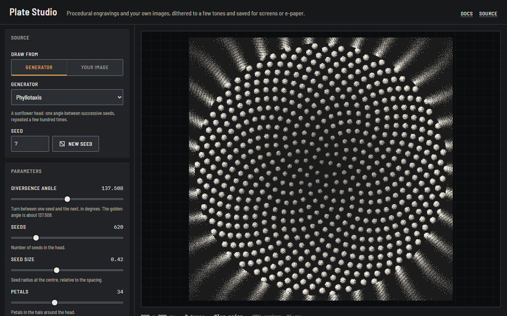

# plate-engine

A dither engine for procedural engravings and ordinary images, and Plate Studio, a browser tool built on it that saves the results for screens and e-paper.



This repository holds two things:

| Folder                                           | What it is                                                                                                                                                                                                                                                                        |
| ------------------------------------------------ | --------------------------------------------------------------------------------------------------------------------------------------------------------------------------------------------------------------------------------------------------------------------------------- |
| [`packages/plate-engine`](packages/plate-engine) | The library: 11 generators, 7 dither methods, 2 to 16 tones, CPU and WebGL renderers, PNG and BMP export. TypeScript, no runtime dependencies. [API docs](https://speyyman.github.io/plate-engine/docs/).                                                                         |
| [`apps/studio`](apps/studio)                     | Plate Studio: pick a generator or drop in your own image, choose a dither and a palette, and download a PNG or BMP, including at the native size of an e-reader panel. Runs in your browser; your image is never uploaded. [Live tool](https://speyyman.github.io/plate-engine/). |

To use the library in your own project: `npm install plate-engine` ([npm](https://www.npmjs.com/package/plate-engine)).

The engine started as the image code of [speyyman.github.io](https://speyyman.github.io). Its golden tests prove it still draws the site's plates bit for bit.

## Quick start

Needs Node 20 or newer.

```sh
git clone https://github.com/speyyman/plate-engine.git
cd plate-engine
npm ci
npm test            # library tests
npm run build       # library to packages/plate-engine/dist, Studio to apps/studio/dist
npm run dev -w plate-studio   # Studio at http://localhost:5173
```

Other scripts:

| Command                                              | Does                                                       |
| ---------------------------------------------------- | ---------------------------------------------------------- |
| `npm run lint`                                       | ESLint and Prettier over the whole repo                    |
| `npm run docs`                                       | TypeDoc API reference into `docs-site/docs`                |
| `npx playwright install chromium` then `npm run e2e` | Studio end-to-end tests against a production build         |
| `npm run bench`                                      | CPU vs WebGL timings and a pixel-for-pixel agreement check |

## Plate Studio

- **Sources**: any of the 11 generators with every parameter on a dial, or your own image (read locally with `createImageBitmap`; nothing leaves the page).
- **Screen**: dither method, cell size, contrast, brightness, gamma, grain, positive or negative.
- **Palettes**: Herbarium (the site's three tones), 1-bit, a four-green handheld-LCD style, newsprint, 4 and 16 greys, or your own 2 to 16 hex colours.
- **E-paper**: presets for the Kobo Clara BW, Kobo Libra 2 and reMarkable 2 at their published resolutions, plus generic 16-, 4- and 2-tone panels with a size you type. Rotation, fill or fit, and export as 8-bit greyscale PNG or 1-, 4- or 8-bit BMP. Sources for each preset are in [`apps/studio/src/devices.ts`](apps/studio/src/devices.ts).
- **Links**: the whole recipe lives in the URL, so a link reproduces the plate exactly.
- **Offline**: a service worker keeps it working after the first visit.
- Every plate is rendered on the CPU in a Web Worker, so what you see is byte for byte what you download.

Its interface has its own small design system, Copyboard, described in [`apps/studio/DESIGN.md`](apps/studio/DESIGN.md).

## How it works

See the [library README](packages/plate-engine/README.md) for the API, the algorithms and the tests, and [BENCHMARKS.md](packages/plate-engine/BENCHMARKS.md) for measured timings.

## Limitations

- WebGL covers the ordered methods only; error diffusion runs on the CPU.
- The e-paper grey levels for the Kobo presets (16) are the figure the MobileRead wiki gives for E Ink Carta panels, since Kobo does not publish one; reMarkable publishes none either, so 16 is assumed. Check your own device.

## Licence

MIT, see [LICENSE](LICENSE). Fonts in Plate Studio (Barlow Semi Condensed, IBM Plex Mono) are under the SIL Open Font License and are bundled from `@fontsource`.

Development was assisted by Claude (Anthropic).
